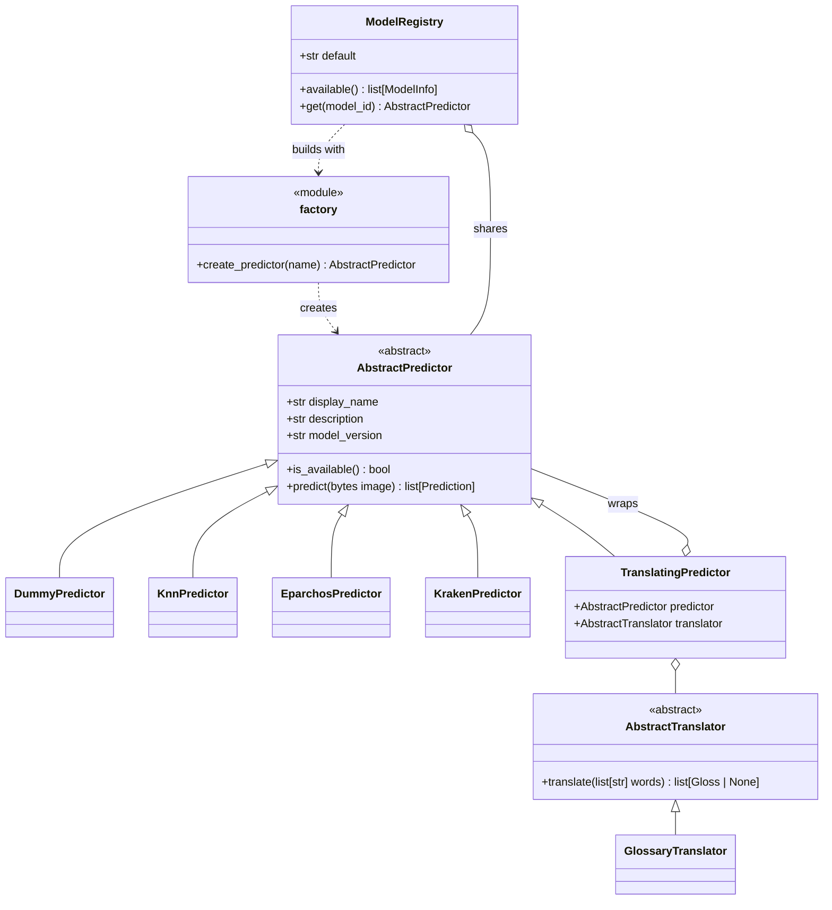

# Design patterns

Patterns that are in the code today. When a new one lands, add a row with the file and the symbol.

| Pattern              | Where                                                                                              | Why                                                                                                                                          |
| -------------------- | -------------------------------------------------------------------------------------------------- | -------------------------------------------------------------------------------------------------------------------------------------------- |
| Factory              | `create_predictor` in `backend/src/ml/factory.py`                                                  | Builds the predictor named by its argument or by the `ML_PREDICTOR` environment variable, so switching models doesn't touch the route.       |
| Registry             | `ModelRegistry` in `backend/src/ml/registry.py`                                                    | Lists the models this install can run and shares one instance of each, built on first use, so a request only names the model it wants.       |
| Strategy             | `AbstractPredictor` in `backend/src/ml/predictor.py`                                               | Every model has the same `predict` and `model_version`, so `/predict` works with any of them.                                                |
| Strategy             | `AbstractTranslator` in `backend/src/ml/translator.py`                                             | The glossary mock and a real translation model can be swapped without touching the predictors.                                               |
| Decorator            | `TranslatingPredictor` in `backend/src/ml/translating_predictor.py`                                | Wraps any predictor and adds a gloss to each word, so no predictor has to know about translation.                                            |
| Dependency injection | `get_predictor` in `backend/src/app/prediction.py`, `capped_image` in `backend/src/app/uploads.py` | FastAPI `Depends` hands the route the predictor the request chose and the checked image bytes, so the route doesn't build them itself.       |
| Repository           | `InMemoryCaptureSessionRepository` in `backend/src/app/capture/repository.py`                      | All storage of phone capture sessions goes through it, so `CaptureService` doesn't know where they live.                                     |
| Repository           | `RecognitionRepository` in `backend/src/app/recognitions/repository.py`                            | All access to saved results goes through it, and every query is scoped to one user.                                                          |
| Repository           | `UserRepository`, `AuthSessionRepository` in `backend/src/app/auth/repository.py`                  | All database access goes through them, so services and routes never run a query.                                                             |
| Service layer        | `CaptureService` in `backend/src/app/capture/service.py`                                           | Holds the session rules (random ids, 30 minute expiry, one photo at a time), so the routes in `backend/src/app/capture/router.py` stay thin. |
| Service layer        | `RecognitionService` in `backend/src/app/recognitions/service.py`                                  | Runs the chosen predictor and saves the page with its result, so the history routes only map errors to status codes.                         |
| Service layer        | `AuthService` in `backend/src/app/auth/service.py`                                                 | Holds the account rules (email format, password length, session expiry), so the auth routes only map errors to status codes.                 |
| Adapter              | `LoadingOrb` in `frontend/src/components/ui/loading-orb.tsx`                                       | The only import of `thinking-orbs`, so the animation library can be swapped in one place.                                                    |

## Predictor classes

`backend/src/app/prediction.py` builds the registry so that every model it hands out is wrapped in a `TranslatingPredictor` with a `GlossaryTranslator`.
